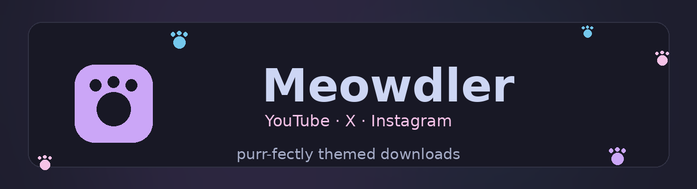
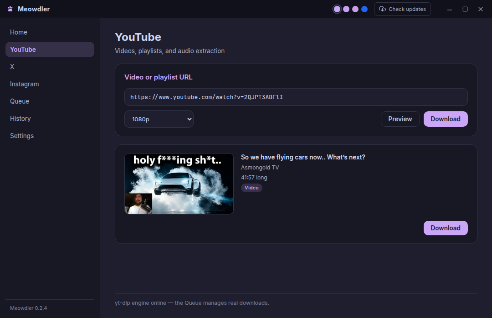

<div align="center">



### 🐾 A soft-pawed downloader for YouTube · X · Instagram

Dressed head-to-toe in [Catppuccin](https://github.com/catppuccin/catppuccin), powered by `yt-dlp`.


[**⬇ Download the latest release**](https://github.com/MB-PieSec/meowdler/releases/latest)

</div>

---

<div align="center">

</div>

## ✨ Highlights

| 🎨  | **Four Catppuccin flavors**        | Mocha, Macchiato, Frappé, and Latte — one click away, restyled live                                               |
| --- | ---------------------------------- | ----------------------------------------------------------------------------------------------------------------- |
| 📥  | **Real download engine**           | Bundled `yt-dlp` + `ffmpeg` + a JavaScript runtime — quality presets from _Best_ down to 360p, audio-only MP3/M4A |
| 👁   | **Previews before you commit**     | Thumbnail, title, uploader + duration — for single videos and playlists (expanded entry by entry)                 |
| 🚦  | **A Queue that behaves**           | Concurrent downloads (1–4, live-tunable), pause / resume / cancel / retry, live per-stream progress               |
| 🗂   | **History that survives restarts** | Finished items persist locally, searchable — with **Open** (system player) and **Show in folder**                 |
| 🏷   | **Source tags**                    | Every row knows where it came from: YouTube / X / Instagram                                                       |
| 🌙  | **Frameless custom titlebar**      | Native-feeling window chrome with a _Check updates_ button                                                        |
| 🔄  | **Self-updating**                  | Checks GitHub on startup — click _Install_, it downloads and relaunches by itself (deb opens the releases page)   |
| 🔒  | **Local-first**                    | Goes straight from the wire to your disk. No accounts, no telemetry, no cloud                                     |

<table>
  <tr>
    <td align="center">🌙<br><b>Mocha</b><br><code>#1e1e2e</code></td>
    <td align="center">🍵<br><b>Macchiato</b><br><code>#24273a</code></td>
    <td align="center">🥛<br><b>Frappé</b><br><code>#303446</code></td>
    <td align="center">☀️<br><b>Latte</b><br><code>#eff1f5</code></td>
  </tr>
</table>

## 📦 Download

Grab a build straight from [Releases](https://github.com/MB-PieSec/meowdler/releases/latest):

| Platform | File                                                                |
| -------- | ------------------------------------------------------------------- |
| Linux    | `Meowdler-<version>.AppImage` · `meowdler_<version>_amd64.deb`      |
| Windows  | `Meowdler.Setup.<version>.exe`                                      |
| macOS    | `Meowdler-<version>-arm64.dmg` · `Meowdler-<version>-arm64-mac.zip` |

Everything ships self-contained — engine, ffmpeg, a JavaScript runtime, icons
and update feeds. No runtime prerequisites.

> **What Meowdler talks to on the network** — media fetching happens
> exclusively through the bundled `yt-dlp` engine, straight to the platform and
> its CDNs. Meowdler's own code contacts GitHub **only**: release feeds and
> installers for update checks, and the official yt-dlp release (API + asset
> download + `SHA2-256SUMS`) when you click _Check engine updates_. Preview
> thumbnails load directly from the platform's image CDNs. No telemetry, no
> analytics, no third parties — ever.

### Platform notes

- **Linux** — the deb keeps the Chromium sandbox; AppImage and unpacked builds
  fall back to a fully unsandboxed browser (zygote **and** renderer) so they
  always start on systems without user-namespaces or an SUID helper. App
  auto-update works for AppImage; deb opens the releases page instead.
- **Windows** (x64) — the NSIS installer is unsigned, so SmartScreen shows the
  classic _"Windows protected your PC"_ prompt: choose **More info → Run
  anyway**. You can change the install folder during setup.
- **macOS** — **Apple Silicon (arm64) only**, and builds are currently
  unsigned: macOS blocks the first launch with _"cannot verify the developer"_ —
  right-click the app → **Open** (or allow it in System Settings → Privacy &
  Security). The notice re-appears for self-updated builds too — the same
  right-click dance clears it.

<details>
<summary>🧪 What ships in every installer (checked per release)</summary>

| Piece                              | Where it comes from                                                                                          | What breaks without it                                                             |
| ---------------------------------- | ------------------------------------------------------------------------------------------------------------ | ---------------------------------------------------------------------------------- |
| `yt-dlp` engine                    | official [yt-dlp releases](https://github.com/yt-dlp/yt-dlp/releases)                                        | no downloads at all                                                                |
| `ffmpeg` (`ffmpeg.exe` on Windows) | distro apt (Linux) · Homebrew (macOS) · [gyan.dev essentials](https://www.gyan.dev/ffmpeg/builds/) (Windows) | stream merging + audio extraction degraded to single-format downloads              |
| `deno` JS runtime (`deno.exe`)     | official [Deno releases](https://github.com/denoland/deno/releases)                                          | YouTube's anti-bot wall cannot be evaluated (Node fallback: x.co posts still work) |
| update feeds (`latest*.yml`)       | generated by CI                                                                                              | app self-update disabled                                                           |

Settings → **Engine** shows the live versions of all three.
</details>

<details>
<summary>🧪 Manual test checklist (Windows / macOS — things I could not exercise on Linux)</summary>

After installing, these should take ~5 minutes and cover the OS-specific paths:

1. **Launch** — Windows: SmartScreen prompt → _More info → Run anyway_; macOS:
   mount the dmg, drag to Applications, right-click → Open (skip Gatekeeper).
2. **Settings → Engine** — yt-dlp, ffmpeg (**`ffmpeg.exe` on Windows**), and
   the JavaScript runtime rows all show versions (not "not found").
3. **Titlebar** — frameless window minimizes / maximizes / closes.
4. **YouTube preview** — paste a video URL, check thumbnail + duration card.
5. **Download a short video** at 720p — the queue fills, the row completes,
   History shows it; **Show in folder** and **Open** both work.
6. **Audio extraction** — `Audio only · MP3` completes (proves the bundled
   `ffmpeg.exe`/`ffmpeg` is executable — this is exactly the Windows packaging
   path fixed for v0.2.7).
7. **Engine update check** — Settings → Check engine updates responds, and the
   app update check in the titlebar opens the dialog.
8. **macOS only** — cookie store read from **Safari**: pick "From a browser" →
   Safari and preview an Instagram post.
9. **Windows only** — after a config-folder change in NSIS, downloads still
   land in the chosen output folder.

</details></think>Now fix the outdated ffmpeg-resolution doc line and complete the project-layout list:<tool_call>edit<arg_key>newString</arg_key><arg_value>
## 🍪 The one thing that needs you

Some platforms gate-keep by who's asking (Instagram basically always; YouTube
sometimes, with bot-wall errors). Meowdler's Settings → **Cookies** covers both:

- **From a browser** — the engine reads a local browser's cookie store directly
  (Brave, Chrome, Chromium, Edge, Firefox, …)
- **From a file** — a Netscape-format `cookies.txt` exported by any extension

Cookies stay on this machine and are used for exactly one thing: sent as
request headers by the engine to the platform you're downloading from — nowhere
else.

Practical notes on cookies:

- **Close the browser first** when using _From a browser_ — some browsers lock
  their cookie store while running (Meowdler will tell you: it detects the
  locked-store and not-installed cases and suggests the fix).
- **Keep the file around** when using _From a file_ — files are validated up
  front (Netscape format, readable), and a cookies file that goes missing after
  being picked fails the download item with a clear message instead of silently
  downloading without cookies. Export **while logged in**, or the file has
  nothing useful in it.

## 🧑‍💻 Build from source

```sh
git clone https://github.com/MB-PieSec/meowdler
cd meowdler && npm install
npm run dev        # hot-reloading dev window
npm run package    # unpacked build in dist/
npm run dist       # installers for your current OS
```

Engine placement and behavior:

- The bundled `resources/yt-dlp` ships inside every package and is resolved via
  `process.resourcesPath`; ffmpeg resolution is cross-platform: packaged
  `resources/ffmpeg` (`ffmpeg.exe` on Windows), the repo copy in dev, system
  locations (`/usr/bin`, `/usr/local/bin`, `/opt/homebrew/bin`), and finally
  whatever the OS PATH resolves. When ffmpeg is missing the UI labels and
  disables merge/audio presets instead of failing mid-download.
- Recent yt-dlp needs a **JavaScript runtime** to evaluate YouTube's
  anti-bot challenges. A per-platform Deno binary (yt-dlp's default runtime,
  MIT-licensed) is bundled into every installer; as fallback Meowdler also
  autodetects Node across version managers (nvm, nvm-windows), Homebrew, and
  system paths, and passes the first hit as `--js-runtimes <deno|node>:<path>`
  — no environment tweaks needed. Settings → Engine shows which runtime is
  live.

## 🔧 Scripts

| Script                 | Description                                    |
| ---------------------- | ---------------------------------------------- |
| `npm run dev`          | Dev server + Electron with hot reload          |
| `npm start`            | Electron with the last built bundle            |
| `npm run build`        | Bundle main / preload / renderer into `out/`   |
| `npm run typecheck`    | Strict type-check, no emit                     |
| `npm run lint`         | ESLint (flat config) · `lint:fix` for auto-fix |
| `npm run format`       | Prettier write · `format:check` to verify      |
| `npm run clean`        | Remove build output                            |
| `npm run package`      | Build + unpacked app in `dist/` (no installer) |
| `npm run dist`         | Installers: AppImage/deb · dmg · nsis per OS   |
| `npm run fetch:ffmpeg` | Stage a system ffmpeg into `resources/`        |

## 🗺 Project layout

```
electron.vite.config.ts     build config for main / preload / renderer
resources/yt-dlp            bundled engine binary (replaced per-OS by CI)
resources/ffmpeg / deno     staged by CI: stream merging + JS runtime
build/icon.*                generated app icons (png / icns / ico)
scripts/                    make-icons.py · make-banner.py · fetch-ffmpeg.sh
src/
  main/                     Electron main process (Node side)
    index.ts                window creation + app lifecycle
    ipc.ts                  typed IPC handler registration
    downloads.ts            DownloadManager: worker pool, lifecycle, ledger
    ytdlp.ts                engine resolution · probing · spawn · runtime detect
    engine-updater.ts       in-app yt-dlp updater (checksum-verified swap)
    progress.ts             pure yt-dlp --newline line parsers
    history.ts              finished-downloads persistence (atomic writes)
    settings.ts             settings.json load/save (userData)
    updater.ts              app self-update flow (electron-updater)
  preload/
    index.ts                contextBridge API (`window.meowdler`)
    window.d.ts             global type declaration of the bridged API
  renderer/
    views.tsx               all live views + shared MediaFormCard
    hooks/useDownloads.tsx  renderer download state (IPC upserts)
    components/ui.tsx       Button/Entry/ProgressBar/Chip widgets
    theme/flavors.css       Catppuccin palettes as CSS variables
  shared/
    downloads.ts            DownloadItem contract + history parser
    settings.ts             AppSettings schema + validators
    ipc.ts                  IPC channel names + payload types
```

`package.json` pins `"type": "module"`; electron-vite bundles main / preload /
renderer so imports are written without extensions.

## ⚙️ Under the hood

- **Update feeds** — releases publish `latest*.yml` files; the app checks GitHub
  on startup (Install / Not-now prompt) and via the titlebar button. In-place
  self-update works for AppImage, Windows NSIS, and the macOS zip target (best
  effort on unsigned macOS builds — the downloadable is still SHA-512-verified
  by electron-updater); deb installs open the releases page instead.
- **Engine updates** — the bundled yt-dlp binary can be refreshed from
  official [yt-dlp releases](https://github.com/yt-dlp/yt-dlp/releases)
  (Settings → Engine → _Check engine updates_), verified against the
  release's SHA2-256SUMS before an atomic swap into your profile folder.
  The swap is skipped while any download is running. Update checks contact
  api.github.com / release-asset storage on GitHub only — nothing else, no
  telemetry.
- **Linux sandboxing** — the deb keeps the Chromium sandbox (SUID-helper
  postinst + AppArmor profile); AppImage and unpacked builds fall back to an
  unsandboxed launch so they never abort the zygote.
- App icons regenerate with `python3 scripts/make-icons.py`, the README banner
  with `python3 scripts/make-banner.py` (PIL only).

## ⚖️ Legal, licensing & attribution

Meowdler's own code is MIT-licensed ([LICENSE](LICENSE)), and so is the
Electron bundling. It ships third-party binaries inside every installer:

| Bundled component            | License     | Upstream                                                                                                   |
| ---------------------------- | ----------- | ---------------------------------------------------------------------------------------------------------- |
| `yt-dlp` (engine)            | Unlicense   | [github.com/yt-dlp/yt-dlp](https://github.com/yt-dlp/yt-dlp)                                               |
| Deno (JS runtime for yt-dlp) | MIT         | [github.com/denoland/deno](https://github.com/denoland/deno)                                               |
| ffmpeg (bundled builds)      | **GPL-3.0** | [ffmpeg.org](https://www.ffmpeg.org) · Windows builds from [gyan.dev](https://www.gyan.dev/ffmpeg/builds/) |
| Chromium / Electron          | MIT         | [electronjs.org](https://www.electronjs.org)                                                               |

`ffmpeg` is distributed as a **GPL-3.0** binary; the GPL applies to that
component. Its full source is available upstream, and the per-platform build
sources used here are documented in `scripts/fetch-ffmpeg.sh` and the CI
workflow (`.github/workflows/release.yml`). Should you re-distribute Meowdler,
keep these license links intact.

**What Meowdler is not:** it is not affiliated with, endorsed by, or connected
to YouTube, X (Twitter), Instagram/Meta, or any platform it can download from.
Downloading content from these platforms is governed by **their terms of
service** — use Meowdler only for content you have the right to save (your own
uploads, Creative-Commons/public-domain material, or content the platform
allows saving). Respect rate limits; mass/scraping use is on you.

Cookies handed to the engine stay on your machine, and Meowdler keeps them
there — but they are **your login credentials**: never use cookie files from
another machine or person.

## 📜 License

MIT · Made with 🩷 by [MB-PieSec](https://github.com/MB-PieSec)
